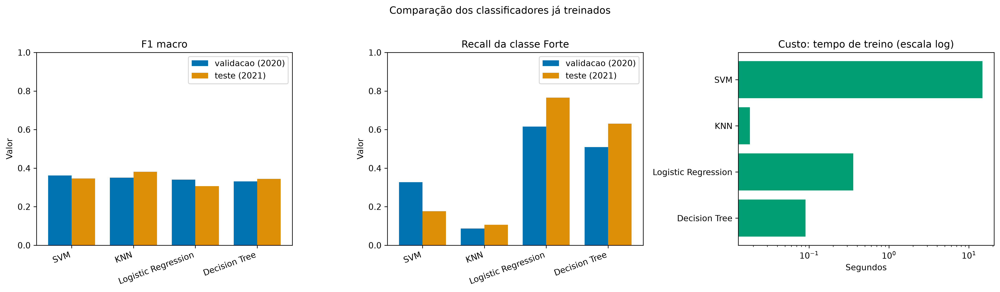

# Comparação dos classificadores — DIA 5

Modelos incluídos: 4 (Grupo 1 — Modelos tradicionais). Quando os outros grupos salvarem `results/metrics/resumo_<grupo>.csv`, rodar `python ml/classification/comparison.py` de novo atualiza esta comparação.

## Como foi feito

- **Dados:** `preprocessing.carregar_dados()`, igual para todos os grupos. Target `classe_chuva_3h` (chuva acumulada nas próximas 3 h em 4 classes: Sem chuva, Fraca, Moderada e Forte), 33 features observadas até *t*, divisão out-of-time: treino 2018, 2019, validação 2020 e teste 2021.
- **Hiperparâmetros:** grade pequena por modelo, ajuste no treino e escolha pelo F1 macro na validação. O teste não participa de nenhuma escolha.
- **Desbalanceamento:** `class_weight="balanced"` nos modelos que aceitam. Escalonamento (`StandardScaler`) dentro do Pipeline, ajustado só no treino.
- **Overfitting:** diferença de F1 macro entre treino e validação; acima de 0,05 = moderado, acima de 0,10 = sim.
- **Seleção:** candidato principal = maior F1 macro na validação. Também entra como candidato o maior recall da classe Forte na validação, desde que o F1 macro fique a no máximo 0,05 do melhor.
- Accuracy aparece só como referência: um modelo que sempre diz "Sem chuva" já teria ~70% de accuracy no teste.

## Tabela comparativa

| # | Modelo | Grupo | F1 macro treino | F1 macro validação | F1 macro teste | F1 ponderado teste | Accuracy teste | Recall Forte validação | Recall Forte teste | Precision Forte teste | Tempo de treino | Tempo de predição (teste) | Overfitting (gap) | Candidato |
|---:|---|---|---:|---:|---:|---:|---:|---:|---:|---:|---:|---:|---|---|
| 1 | SVM | Grupo 1 — Modelos tradicionais | 0,494 | 0,362 | 0,347 | 0,594 | 0,537 | 0,327 | 0,177 | 0,048 | 14,8 s | 6,94 s | sim (0,132) | melhor F1 macro (validação) |
| 2 | KNN | Grupo 1 — Modelos tradicionais | 1,000 | 0,350 | 0,382 | 0,678 | 0,706 | 0,087 | 0,106 | 0,231 | 0,0 s | 0,14 s | sim (0,650) | — |
| 3 | Logistic Regression | Grupo 1 — Modelos tradicionais | 0,373 | 0,341 | 0,307 | 0,546 | 0,479 | 0,615 | 0,766 | 0,089 | 0,4 s | 0,00 s | nao (0,033) | melhor recall Forte (validação) |
| 4 | Decision Tree | Grupo 1 — Modelos tradicionais | 0,388 | 0,331 | 0,345 | 0,598 | 0,542 | 0,510 | 0,631 | 0,076 | 0,1 s | 0,00 s | moderado (0,057) | — |

## Leitura

- **Melhor desempenho geral:** SVM, com F1 macro 0,362 na validação e 0,347 no teste.
- **Chuva mais intensa:** o maior recall da classe Forte na validação é do Logistic Regression (0,615; no teste, 0,766). Para um sistema de alerta, deixar passar chuva forte é o erro mais caro, por isso esse recall pesa na escolha.
- **Falsos alarmes:** a precisão da classe Forte no teste fica entre 0,048 e 0,231. Ou seja, a maioria dos avisos de chuva forte não se confirma. Recall alto com precisão baixa é o padrão esperado com `class_weight="balanced"` numa classe de ~1,5% dos registros, e deve ser considerado na hora de definir o limiar do alerta.
- **Generalização:** indícios de overfitting em SVM, KNN, Decision Tree. A comparação validação × teste mostra se o desempenho se mantém num ano que o modelo nunca viu. Ver a coluna "Configuração" abaixo para modelos em que o gap não se aplica (KNN).
- **Custo computacional:** o mais rápido para treinar foi o KNN (0,0 s) e o mais lento o SVM (14,8 s). Tempos medidos numa única máquina; servem para comparar ordem de grandeza.

## Candidatos ao modelo final

- **SVM** — melhor F1 macro (validação): F1 macro 0,362 na validação e 0,347 no teste; recall Forte 0,327 / 0,177.
- **Logistic Regression** — melhor recall Forte (validação): F1 macro 0,341 na validação e 0,307 no teste; recall Forte 0,615 / 0,766.

A decisão final sai depois que os Grupos 2 e 3 adicionarem os resultados de ensembles e boosting.

## Parâmetros registrados

| Modelo | Hiperparâmetros escolhidos | Configuração |
|---|---|---|
| SVM | `C=0.3` | Kernel RBF; StandardScaler + class_weight='balanced'. |
| KNN | `n_neighbors=5` | StandardScaler; KNN nao aceita class_weight (sem compensacao do desbalanceamento). Com weights='distance' cada ponto de treino e vizinho de si mesmo, entao o F1 de treino e sempre 1 e o gap treino-validacao nao indica overfitting real. |
| Logistic Regression | `C=0.01` | Baseline linear; StandardScaler + class_weight='balanced'. |
| Decision Tree | `max_depth=6` | Sem escalonamento (arvore nao depende de escala); class_weight='balanced', min_samples_leaf=20. |

## Arquivos

- `metrics/resumo_<grupo>.csv`: uma linha por modelo (métricas, tempos, parâmetros).
- `metrics/<modelo>_metricas.csv`: todas as métricas por partição e por classe.
- `metrics/<modelo>_grade.csv`: resultado de cada hiperparâmetro testado na validação.
- `confusion_matrices/<modelo>.png` e `.csv`: matrizes de confusão de validação e teste.
- `metrics/comparativo_modelos.csv` e `figures/comparativo_modelos.png/.pdf`: esta comparação.
