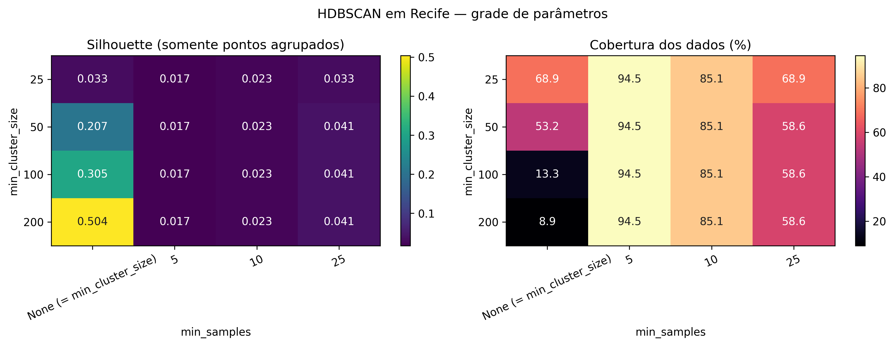
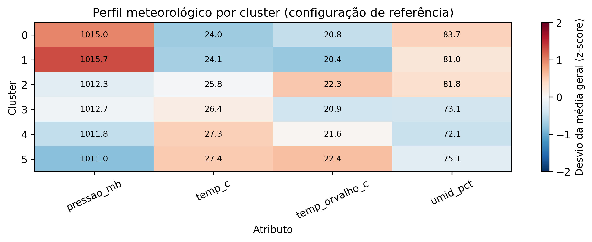

# Experimento HDBSCAN — Recife (INMET A301)

## Base e preparação

- CSV de entrada: dados/df_recife_datetime.csv (SHA-256 c5eb0aa028e8ff569159a5ee83455834cebc81f51e051a165784063a8d83a2b0).
- Preparação: ml/features.py::preparar_base, sem Open-Meteo e sem filtro de anos; o leitor preenche lacunas meteorológicas usando apenas valores anteriores.
- Registros preparados: 33,371; usados: 33,371; removidos sem entradas completas: 0.
- Período: 2018-01-03 a 2021-11-12.
- Features, alinhadas ao K-Means de Recife: pressao_mb, temp_c, temp_orvalho_c, umid_pct, hora_sin, hora_cos, mes_sin, mes_cos.
- Pré-processamento: StandardScaler e PCA até 95% de variância (6 componentes; 97.61% retidos).
- HDBSCAN do scikit-learn 1.3.2, distância euclidiana. min_samples=None usa o padrão igual a min_cluster_size.

## Grade de parâmetros

Silhouette, Davies–Bouldin e Calinski–Harabasz foram calculados somente nos pontos agrupados; Silhouette usa uma amostra fixa de até 4,000 pontos não-ruído. A cobertura e o percentual de ruído usam a base toda.

| min_cluster_size | min_samples | clusters | ruído (n) | ruído | cobertura | Silhouette | Davies–Bouldin | Calinski–Harabasz |
|---:|---:|---:|---:|---:|---:|---:|---:|---:|
| 25 | None (= min_cluster_size) | 4 | 10,385 | 31.12% | 68.88% | 0.0334 | 1.9584 | 2677.9 |
| 25 | 5 | 6 | 1,850 | 5.54% | 94.46% | 0.0168 | 3.7754 | 2914.7 |
| 25 | 10 | 6 | 4,987 | 14.94% | 85.06% | 0.0229 | 3.6482 | 2745.9 |
| 25 | 25 | 4 | 10,385 | 31.12% | 68.88% | 0.0334 | 1.9584 | 2677.9 |
| 50 | None (= min_cluster_size) | 2 | 15,633 | 46.85% | 53.15% | 0.2067 | 1.9275 | 4379.5 |
| 50 | 5 | 6 | 1,850 | 5.54% | 94.46% | 0.0168 | 3.7754 | 2914.7 |
| 50 | 10 | 6 | 4,987 | 14.94% | 85.06% | 0.0229 | 3.6482 | 2745.9 |
| 50 | 25 | 6 | 13,807 | 41.37% | 58.63% | 0.0415 | 3.2041 | 2214.4 |
| 100 | None (= min_cluster_size) | 4 | 28,939 | 86.72% | 13.28% | 0.3052 | 0.8837 | 1982.3 |
| 100 | 5 | 6 | 1,850 | 5.54% | 94.46% | 0.0168 | 3.7754 | 2914.7 |
| 100 | 10 | 6 | 4,987 | 14.94% | 85.06% | 0.0229 | 3.6482 | 2745.9 |
| 100 | 25 | 6 | 13,807 | 41.37% | 58.63% | 0.0415 | 3.2041 | 2214.4 |
| 200 | None (= min_cluster_size) | 2 | 30,393 | 91.08% | 8.92% | 0.5040 | 0.7819 | 2630.4 |
| 200 | 5 | 6 | 1,850 | 5.54% | 94.46% | 0.0168 | 3.7754 | 2914.7 |
| 200 | 10 | 6 | 4,987 | 14.94% | 85.06% | 0.0229 | 3.6482 | 2745.9 |
| 200 | 25 | 6 | 13,807 | 41.37% | 58.63% | 0.0415 | 3.2041 | 2214.4 |

## Referência de alta cobertura

Referência de alta cobertura: min_cluster_size=25, min_samples=5; cobertura 94.46% e Silhouette 0.0168. A maior Silhouette foi 0.5040 em min_cluster_size=200, min_samples=None (= min_cluster_size), mas cobre apenas 8.92% dos registros. Nenhuma configuração deve ser tratada como melhor sem considerar conjuntamente ruído, cobertura e separação.

O rótulo -1 representa ruído; os outros clusters foram numerados pela temperatura média crescente.

| Cluster | Registros | Participação |
|---:|---:|---:|
| -1 | 1,850 | 5.54% |
| 0 | 2,790 | 8.36% |
| 1 | 2,736 | 8.20% |
| 2 | 11,128 | 33.35% |
| 3 | 9,868 | 29.57% |
| 4 | 2,521 | 7.55% |
| 5 | 2,478 | 7.43% |

| Cluster | Registros | Temp. do ar (°C) | Ponto de orvalho (°C) | Umidade (%) | Pressão (mB) |
|---:|---:|---:|---:|---:|---:|
| 0 | 2,790 | 23.97 | 20.83 | 83.66 | 1014.96 |
| 1 | 2,736 | 24.10 | 20.43 | 80.96 | 1015.70 |
| 2 | 11,128 | 25.85 | 22.28 | 81.81 | 1012.31 |
| 3 | 9,868 | 26.37 | 20.93 | 73.14 | 1012.67 |
| 4 | 2,521 | 27.29 | 21.56 | 72.09 | 1011.76 |
| 5 | 2,478 | 27.41 | 22.36 | 75.10 | 1011.00 |

## Reprodutibilidade

- Python 3.12.16; scikit-learn 1.3.2; pandas 2.3.3; NumPy 1.26.4.
- PCA e HDBSCAN usam as entradas completas após a preparação; somente Silhouette é amostrada.
- Comando: venv/bin/python ml/experimento_hdbscan_recife.py.
- Arquivos: metricas_hdbscan.csv, distribuicao_clusters.csv, perfis_clusters.csv, registros_clusterizados.csv e reproducibilidade.json.
