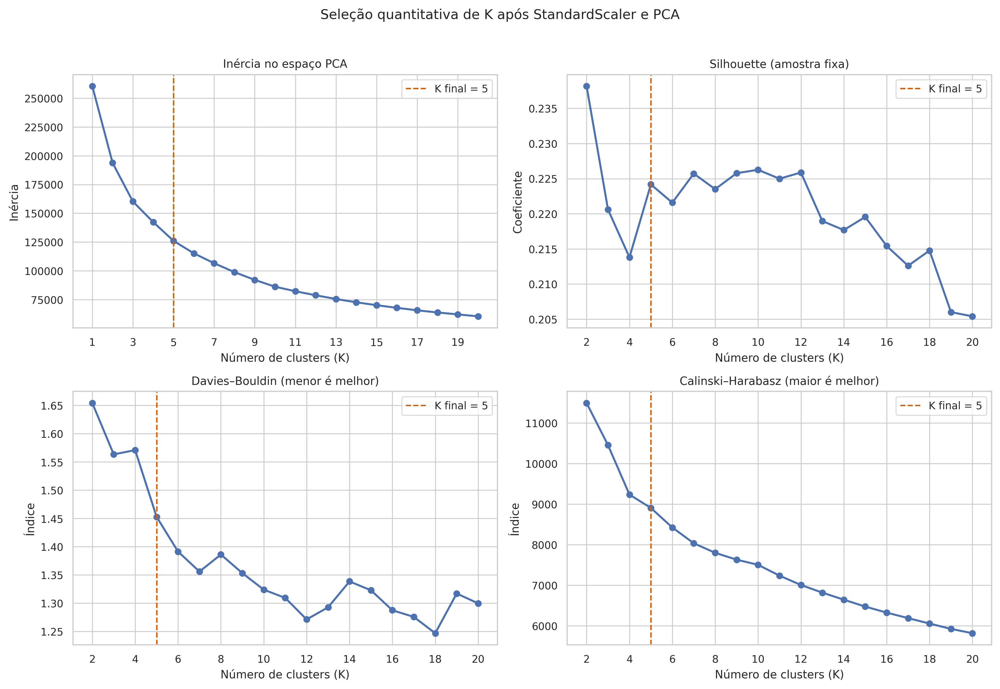
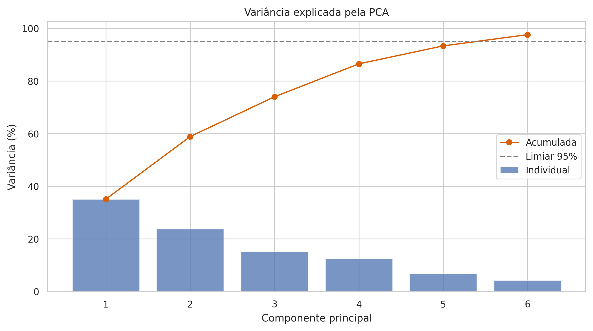
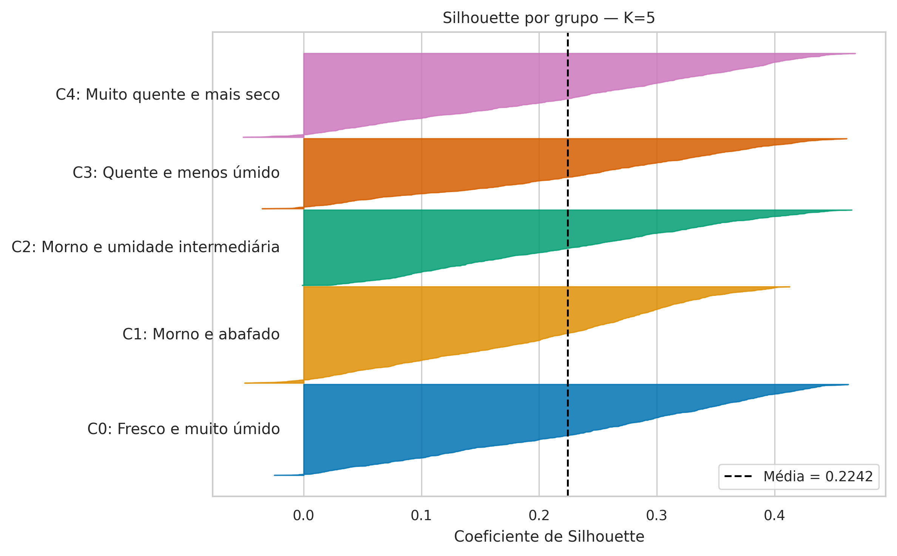
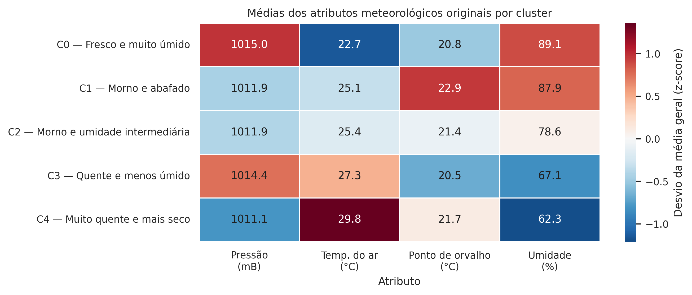

# Experimento K-Means — Recife (INMET A301)

## Método e reprodutibilidade

- Base preparada por `ml/features.py::preparar_base`, com a série completa disponível; linhas sem entradas completas são removidas.
- `ler_csv` ordena a série e preenche ausências meteorológicas com o último valor anterior. Neste CSV, 109 registros tinham ponto de orvalho e umidade ausentes; ambos foram imputados por esse forward-fill causal.
- 33.371 registros usados (2018-01-03 a 2021-11-12).
- Entradas do K-Means: pressao_mb, temp_c, temp_orvalho_c, umid_pct, hora_sin, hora_cos, mes_sin, mes_cos. Chuva observada e alvos futuros foram excluídos.
- `StandardScaler` seguido de PCA antes de calcular Elbow, Silhouette, Davies-Bouldin e Calinski-Harabasz. O limiar de retenção foi 95%: 6 componentes retiveram 97,61% da variância.
- KMeans avaliado para K=2–20, com `n_init=10` e `random_state=42`. A inércia também foi calculada para K=1 como referência do Elbow.
- Silhouette calculada no espaço PCA sobre uma amostra fixa aleatória de 4.000 registros; os demais índices usam os registros completos.
- Ambiente: Python 3.12.16, scikit-learn 1.3.2, pandas 2.3.3, NumPy 1.26.4.
- SHA-256 do CSV de entrada: `c5eb0aa028e8ff569159a5ee83455834cebc81f51e051a165784063a8d83a2b0`.
- A escolha de K e as interpretações estão vinculadas a esse hash; o script interrompe a execução se o CSV mudar.

## Comparação quantitativa

| K | Inércia PCA | Redução da inércia vs. K anterior | Silhouette | Davies–Bouldin ↓ | Calinski–Harabasz ↑ |
|---:|---:|---:|---:|---:|---:|
| 2 | 193.830,1 | 25,62% | 0,2382 | 1,6541 | 11.494,8 |
| 3 | 160.205,6 | 17,35% | 0,2206 | 1,5632 | 10.455,2 |
| 4 | 142.369,0 | 11,13% | 0,2138 | 1,5707 | 9.236,6 |
| 5 | 126.030,2 | 11,48% | 0,2242 | 1,4527 | 8.906,7 |
| 6 | 115.182,3 | 8,61% | 0,2216 | 1,3913 | 8.424,7 |
| 10 | 86.162,0 | 6,43% | 0,2263 | 1,3238 | 7.504,5 |

A Silhouette e o Calinski–Harabasz atingem seus maiores valores em K=2 (0,2382 e 11.494,8). K=5 mantém Silhouette próxima (0,2242, 94,1% do máximo), supera K=3 (0,2206) e reduz Davies–Bouldin de 1,5632 para 1,4527. No Elbow, a redução marginal da inércia cai de 11,48% em K=5 para 8,61% em K=6. K=10 aumenta Silhouette em apenas 0,0021 sobre K=5, ao custo de dobrar o número de grupos.

**K final: 5.** K=2 apresenta o maior valor isolado de Silhouette, mas forma apenas dois regimes amplos. K=5 equilibra separação e interpretação: seus cinco grupos têm perfis meteorológicos distintos e participação entre 16,68% e 22,77%. A melhoria marginal da inércia diminui a partir de K=5; K=10 oferece ganho pequeno de Silhouette, mas fragmenta os perfis em mais grupos. Assim, a escolha combina Elbow, Silhouette, Davies–Bouldin, distribuição e leitura física; nenhum índice isolado ou aparência do gráfico determinou K.

## Distribuição dos grupos

| Grupo interpretado | Registros | Participação |
|---|---:|---:|
| 0 — Fresco e muito úmido | 7.202 | 21,58% |
| 1 — Morno e abafado | 7.600 | 22,77% |
| 2 — Morno e umidade intermediária | 6.245 | 18,71% |
| 3 — Quente e menos úmido | 5.566 | 16,68% |
| 4 — Muito quente e mais seco | 6.758 | 20,25% |

## Perfil estatístico nos atributos meteorológicos originais

Os clusters foram ordenados pela temperatura média crescente para tornar seus rótulos reproduzíveis. A leitura abaixo usa pressão, temperatura do ar, ponto de orvalho e umidade nas unidades originais. IQR é o intervalo interquartil e, junto ao desvio-padrão, mostra a variabilidade dentro de cada grupo.

| Grupo | Atributo | Média | Mediana | Desvio-padrão | IQR |
|---|---|---:|---:|---:|---:|
| 0 — Fresco e muito úmido | Pressão atmosférica | 1.014,99 mB | 1.014,90 mB | 1,57 mB | 2,10 mB |
| 0 — Fresco e muito úmido | Temperatura do ar | 22,73 °C | 22,70 °C | 1,40 °C | 1,90 °C |
| 0 — Fresco e muito úmido | Ponto de orvalho | 20,79 °C | 20,80 °C | 1,23 °C | 1,60 °C |
| 0 — Fresco e muito úmido | Umidade relativa | 89,12 % | 91,00 % | 6,61 % | 7,00 % |
| 1 — Morno e abafado | Pressão atmosférica | 1.011,86 mB | 1.011,90 mB | 1,50 mB | 2,10 mB |
| 1 — Morno e abafado | Temperatura do ar | 25,06 °C | 24,70 °C | 1,65 °C | 2,50 °C |
| 1 — Morno e abafado | Ponto de orvalho | 22,87 °C | 22,70 °C | 1,06 °C | 1,30 °C |
| 1 — Morno e abafado | Umidade relativa | 87,89 % | 90,00 % | 5,93 % | 8,00 % |
| 2 — Morno e umidade intermediária | Pressão atmosférica | 1.011,94 mB | 1.011,90 mB | 1,43 mB | 1,90 mB |
| 2 — Morno e umidade intermediária | Temperatura do ar | 25,43 °C | 25,70 °C | 1,42 °C | 1,90 °C |
| 2 — Morno e umidade intermediária | Ponto de orvalho | 21,38 °C | 21,40 °C | 0,93 °C | 1,30 °C |
| 2 — Morno e umidade intermediária | Umidade relativa | 78,64 % | 77,00 % | 7,14 % | 11,00 % |
| 3 — Quente e menos úmido | Pressão atmosférica | 1.014,44 mB | 1.014,30 mB | 1,73 mB | 2,30 mB |
| 3 — Quente e menos úmido | Temperatura do ar | 27,29 °C | 27,30 °C | 1,47 °C | 2,10 °C |
| 3 — Quente e menos úmido | Ponto de orvalho | 20,54 °C | 20,60 °C | 1,27 °C | 1,70 °C |
| 3 — Quente e menos úmido | Umidade relativa | 67,09 % | 67,00 % | 7,31 % | 10,00 % |
| 4 — Muito quente e mais seco | Pressão atmosférica | 1.011,08 mB | 1.011,10 mB | 1,53 mB | 2,20 mB |
| 4 — Muito quente e mais seco | Temperatura do ar | 29,75 °C | 29,80 °C | 1,37 °C | 2,10 °C |
| 4 — Muito quente e mais seco | Ponto de orvalho | 21,66 °C | 21,70 °C | 1,25 °C | 1,70 °C |
| 4 — Muito quente e mais seco | Umidade relativa | 62,27 % | 62,00 % | 6,92 % | 10,00 % |

### Cluster 0 — Fresco e muito úmido

É o grupo mais fresco e tem a maior pressão média. A umidade relativa é alta e o ponto de orvalho fica abaixo dos grupos mais abafados.

### Cluster 1 — Morno e abafado

Apesar da temperatura amena, combina umidade relativa alta com o maior ponto de orvalho entre os grupos. A pressão média é baixa; o conjunto caracteriza ar morno e abafado, com bastante vapor d'água.

### Cluster 2 — Morno e umidade intermediária

Tem temperatura intermediária e umidade relativa entre os grupos úmidos e os mais secos. A pressão é semelhante à do grupo morno e abafado, mas o ponto de orvalho é menor e a umidade relativa intermediária caracteriza uma condição de transição.

### Cluster 3 — Quente e menos úmido

É quente e menos úmido que os três grupos de menor temperatura. A pressão média é relativamente alta, o que o distingue do grupo mais quente, mesmo com umidade relativa igualmente baixa.

### Cluster 4 — Muito quente e mais seco

É o grupo mais quente e tem a menor umidade relativa. Como o ponto de orvalho não aumenta na mesma proporção que a temperatura do ar, apresenta a maior diferença entre essas duas medidas e caracteriza o regime mais quente e seco.

## Arquivos

- `metricas_k.csv`: inércia e índices para todos os K avaliados.
- `distribuicao_clusters.csv`: contagens e participação dos registros.
- `perfis_clusters.csv`: médias, medianas e variabilidade por atributo original.
- `registros_clusterizados.csv`: timestamp, atributos originais, rótulo e nome do regime.
- `reproducibilidade.json`: configuração, versões e hash da base.
- `figuras/`: versões PNG (300 dpi) e PDF dos gráficos para o artigo.

Para reproduzir a execução na raiz do repositório: `venv/bin/python ml/experimento_kmeans.py`.
