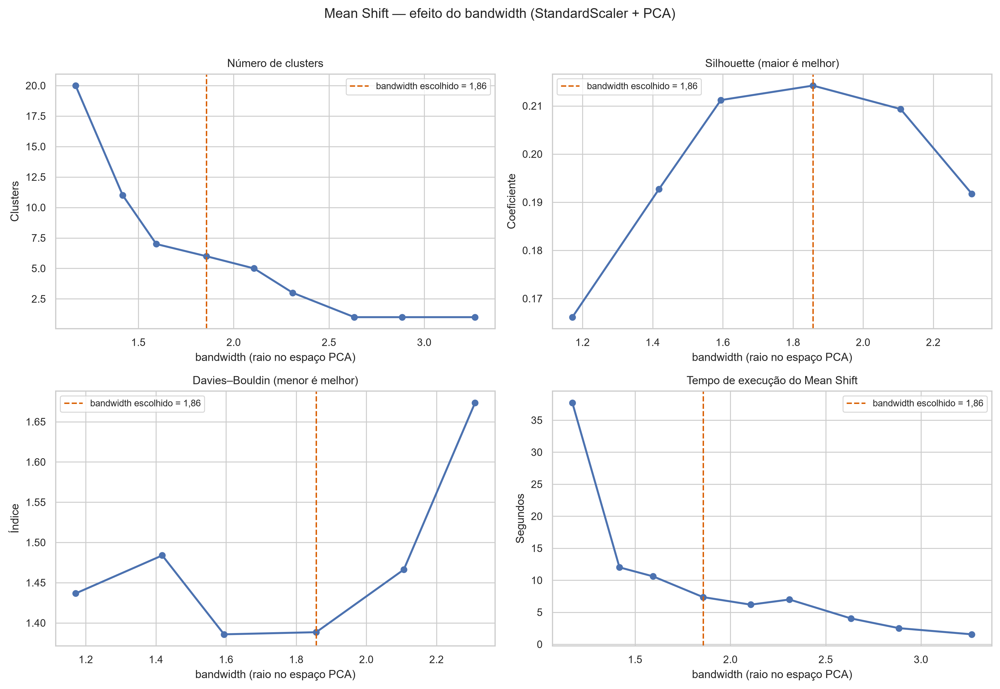
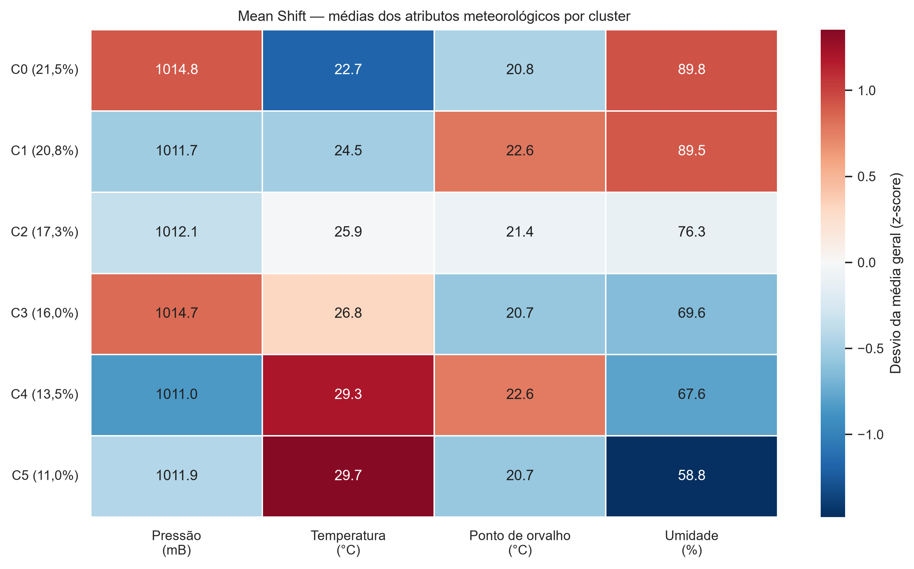
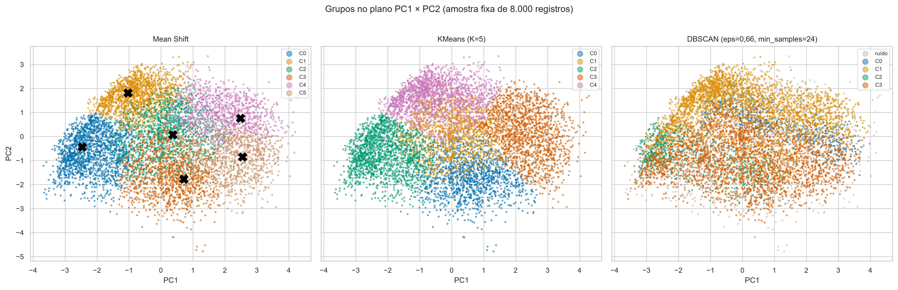

# Experimento Mean Shift — Recife (INMET A301)

## Método e reprodutibilidade

- Mesma matriz do K-Means, DBSCAN e HDBSCAN: `preparar_base(usar_open_meteo=False, filtrar_anos=False)`, as 8 features de clustering (pressao_mb, temp_c, temp_orvalho_c, umid_pct, hora_sin, hora_cos, mes_sin, mes_cos), `StandardScaler` e PCA com ≥ 95% da variância (6 componentes, 97,61%). Chuva e alvos não entram (`validar_sem_leakage(modo="clustering")`).
- 33.371 registros (2018-01-03 a 2021-11-12).
- Métricas calculadas pela mesma função do experimento HDBSCAN (`_evaluate_partition`): Silhouette numa amostra fixa de 5.000 registros (mesma semente), Davies–Bouldin e Calinski–Harabasz na base inteira.
- Mean Shift com `bin_seeding=True` (sementes numa grade de lado igual ao bandwidth), `min_bin_freq=5` e `cluster_all=True` (todo registro recebe o cluster da moda mais próxima, então não há ruído).
- O Mean Shift é determinístico com essas opções: rodar de novo dá os mesmos grupos, por isso não há avaliação de estabilidade por sementes como no K-Means.
- Python 3.12.7, scikit-learn 1.9.1, pandas 3.1.1, NumPy 2.5.5. SHA-256 do CSV: `c60f196d55ac75e0e45d03284831d8c76442faba5806d09083da8656f4c8b4a1`.

## Avaliação do bandwidth

O Mean Shift não recebe o número de clusters. Ele desloca cada semente na direção de maior densidade até chegar a uma moda, e cada moda vira um cluster. O único parâmetro relevante é o **bandwidth**, o raio da vizinhança usada para estimar a densidade. Ele foi derivado de quantis das distâncias entre pares de pontos (`estimate_bandwidth`, amostra de 3.000).

| Quantil | Bandwidth | Clusters | Menor cluster | Maior cluster | Silhouette | Davies–Bouldin ↓ | Calinski–Harabasz ↑ | Órfãos* | Tempo |
|---:|---:|---:|---:|---:|---:|---:|---:|---:|---:|
| 0,010 | 1,171 | 20 | 0,4% | 10,7% | 0,1661 | 1,437 | 4.616 | 66,3% | 37,7 s |
| 0,020 | 1,418 | 11 | 5,9% | 13,2% | 0,1927 | 1,484 | 6.448 | 57,9% | 12,0 s |
| 0,030 | 1,594 | 7 | 10,4% | 19,9% | 0,2112 | 1,386 | 7.713 | 59,8% | 10,6 s |
| 0,050 | 1,857 | 6 | 11,0% | 21,5% | 0,2142 | 1,388 | 8.185 | 46,6% | 7,4 s | **← escolhido**
| 0,075 | 2,107 | 5 | 17,7% | 22,9% | 0,2094 | 1,466 | 8.538 | 36,6% | 6,2 s |
| 0,100 | 2,310 | 3 | 23,8% | 45,8% | 0,1918 | 1,674 | 8.763 | 46,1% | 7,0 s |
| 0,150 | 2,633 | 1 | 100,0% | 100,0% | — | — | — | 58,2% | 4,0 s |
| 0,200 | 2,884 | 1 | 100,0% | 100,0% | — | — | — | 42,4% | 2,5 s |
| 0,300 | 3,266 | 1 | 100,0% | 100,0% | — | — | — | 18,7% | 1,6 s |

\* Registros a mais de um bandwidth da moda mais próxima. Com `cluster_all=False` eles seriam marcados como ruído (−1). Mostram quanto da base fica longe dos picos de densidade.

- O número de clusters cai rápido conforme o bandwidth cresce: 20 clusters com bandwidth 1,17 e apenas 1 cluster a partir de 2,63. Isso mostra que a base não tem várias modas bem separadas; os regimes meteorológicos formam um contínuo, como o K-Means e o DBSCAN já indicavam (Silhouette baixa em todos).
- Bandwidths pequenos são mais lentos, porque geram mais sementes para deslocar.

**Configuração escolhida: quantil 0,050, bandwidth 1,857, 6 clusters.** Regra fixada antes de olhar os resultados: entre as configurações com 3 a 10 clusters e nenhum cluster menor que 1% dos registros, a de maior Silhouette (empate pelo menor Davies–Bouldin). Abaixo de 3 grupos o resultado não descreve regimes; acima de 10, fragmenta demais para interpretar; clusters com menos de 1% são pequenos demais para caracterizar.

## Clusters encontrados e perfil meteorológico

Clusters ordenados pela temperatura média crescente, no mesmo critério do HDBSCAN. A chuva não entrou no ajuste; aparece só como validação externa.

| Cluster | Registros | Temp. | Umidade | Orvalho | Pressão | Hora mediana | % quadra chuvosa | % horas com chuva | Leitura (desvios ≥ 0,5σ) |
|---|---:|---:|---:|---:|---:|---:|---:|---:|---|
| C0 | 7.166 (21,5%) | 22,7 °C | 90% | 20,8 °C | 1.014,8 mB | 6h | 53% | 26,5% | mais fresco (-1,2σ), mais úmido (0,9σ), pressão mais alta (0,9σ) |
| C1 | 6.928 (20,8%) | 24,5 °C | 89% | 22,6 °C | 1.011,7 mB | 6h | 50% | 23,7% | mais úmido (0,9σ), orvalho mais alto (0,8σ), pressão mais baixa (-0,5σ), mais fresco (-0,5σ) |
| C2 | 5.777 (17,3%) | 25,9 °C | 76% | 21,4 °C | 1.012,1 mB | 19h | 1% | 5,0% | próximo da média geral em todos os atributos |
| C3 | 5.332 (16,0%) | 26,8 °C | 70% | 20,7 °C | 1.014,7 mB | 13h | 45% | 7,4% | pressão mais alta (0,8σ), mais seco (-0,6σ), orvalho mais baixo (-0,6σ) |
| C4 | 4.503 (13,5%) | 29,3 °C | 68% | 22,6 °C | 1.011,0 mB | 14h | 43% | 5,6% | mais quente (1,2σ), pressão mais baixa (-0,8σ), mais seco (-0,8σ), orvalho mais alto (0,8σ) |
| C5 | 3.665 (11,0%) | 29,7 °C | 59% | 20,7 °C | 1.011,9 mB | 12h | 0% | 1,4% | mais seco (-1,5σ), mais quente (1,4σ), orvalho mais baixo (-0,6σ) |

O cluster com mais horas de chuva é o C0 (26,5% das horas, mais fresco (-1,2σ), mais úmido (0,9σ), pressão mais alta (0,9σ)); o mais seco é o C5 (1,4%, mais seco (-1,5σ), mais quente (1,4σ), orvalho mais baixo (-0,6σ)). Ou seja, mesmo sem usar chuva no ajuste, o Mean Shift separa regimes associados a chuva de regimes quase sem chuva.

## Comparação inicial com KMeans e DBSCAN

As três partições foram recalculadas na **mesma matriz** e avaliadas pela **mesma função**, então os números são comparáveis entre si. KMeans com o K final do `reports/kmeans_recife` (K=5); DBSCAN com a configuração escolhida no `Notebooks/dbscan_recife.ipynb` (C6). ARI mede a concordância com o Mean Shift (1 = partições idênticas, 0 = acaso).

| Algoritmo | Parâmetros | Clusters | Ruído | Silhouette | Davies–Bouldin ↓ | Calinski–Harabasz ↑ | % horas com chuva por cluster (mín–máx) | Tempo | ARI vs. Mean Shift |
|---|---|---:|---:|---:|---:|---:|---|---:|---:|
| Mean Shift | bandwidth=1,857 (quantil 0,050) | 6 | 0,0% | 0,2142 | 1,388 | 8.185 | 1,4–26,5% | 7,36 s | 1,000 |
| KMeans | K=5, n_init=10 | 5 | 0,0% | 0,2173 | 1,453 | 8.907 | 2,3–26,2% | 0,27 s | 0,630 |
| DBSCAN | eps=0.66, min_samples=24 | 4 | 10,1% | 0,0222 | 2,131 | 3.272 | 6,5–23,8% | 1,31 s | 0,161 |

- **Separação:** a maior Silhouette é do KMeans. Os valores dos três continuam baixos (todos abaixo de 0,3), coerente com regimes que se sobrepõem.
- **Nota sobre a Silhouette do KMeans:** aqui ela é 0,2173, e em `reports/kmeans_recife` é 0,2242. A partição é a mesma configuração (K=5, `random_state=42`); a diferença vem só da amostra usada no cálculo (5.000 registros com a semente do HDBSCAN aqui, 4.000 com outra semente lá). Para comparar algoritmos, usar os valores desta tabela, que vêm todos da mesma amostra.
- **Concordância:** ARI de 0,630 com o KMeans e 0,161 com o DBSCAN.
- **Ruído:** o Mean Shift, como o KMeans, atribui todos os registros. O DBSCAN deixa 10,1% como ruído. A coluna de órfãos da grade mostra o equivalente no Mean Shift se o modo `cluster_all=False` fosse usado.
- **Chuva (validação externa):** a % de horas com chuva varia de 1,4% a 26,5% entre os clusters do Mean Shift, contra 2,3–26,2% no KMeans e 6,5–23,8% no DBSCAN. Quanto maior a diferença, mais os grupos separam situações com e sem chuva.
- **Tempo:** o mais rápido foi o KMeans. O Mean Shift levou 7,4 s com o bandwidth escolhido; a grade inteira levou 97 s.

## Para o cartão "DIA 4 — Comparação KMeans, DBSCAN, HDBSCAN e Mean Shift"

- Métricas, tempo e parâmetros do Mean Shift: `comparacao_kmeans_dbscan.csv` (linha "Mean Shift") e `metricas_bandwidth.csv`.
- Rótulo de cada registro, para cruzar com os outros algoritmos pela coluna `datetime`: `registros_clusterizados.csv`.
- Perfil de cada grupo: `perfis_clusters.csv`.
- Figuras em PNG (300 dpi) e PDF em `figuras/`.

## Arquivos

- `metricas_bandwidth.csv`: grade completa (quantil, bandwidth, clusters, métricas, órfãos, tempos).
- `distribuicao_clusters.csv` e `perfis_clusters.csv`: tamanho e perfil de cada cluster.
- `comparacao_kmeans_dbscan.csv`: Mean Shift × KMeans × DBSCAN na mesma matriz.
- `registros_clusterizados.csv`: `datetime`, atributos originais e `cluster`.
- `reproducibilidade.json`: configuração, versões e hash da base.

Para reproduzir, na raiz do repositório: `python ml/experimento_meanshift_recife.py`.
