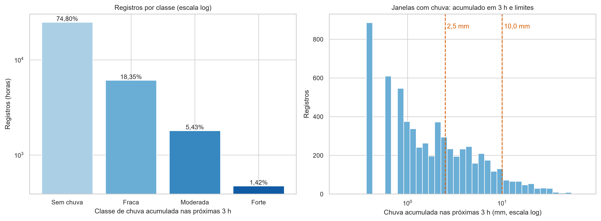
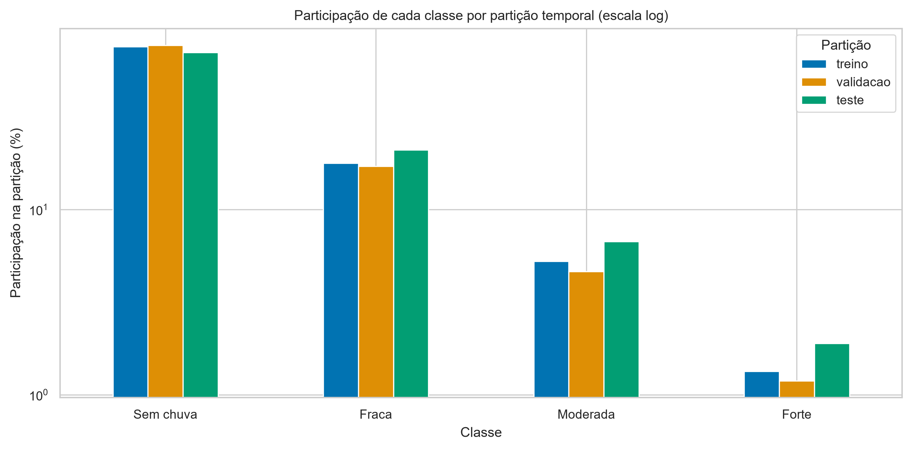
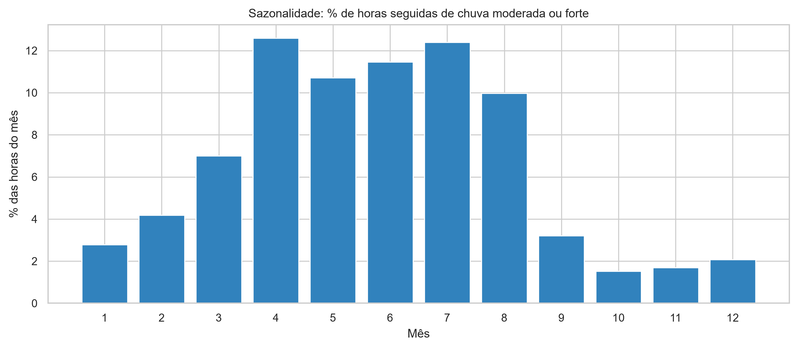

# DIA 2 — Definição de target e estratégia de classificação (Recife, INMET A301)

## 1. Definição do target

**Pergunta de previsão:** dado o estado atmosférico observado até a hora *t*, qual será a intensidade da chuva **acumulada nas próximas 3 horas** (*t*+1, *t*+2 e *t*+3)?

- **Variável base:** `acum_fut_3h` — soma de `precip_mm` em *t*+1..*t*+3, criada em `ml/features.py::construir_features`. A hora *t* **não** entra na soma; isso é verificado pelo script ao recalcular a soma a partir de `precip_mm`.
- **Target multiclasse ordinal:** `classe_chuva_3h` ∈ {0, 1, 2, 3}, obtido por `classificar()` em `ml/experimento_target.py`.
- **Janelas inválidas:** se alguma das 3 horas futuras não tiver medição, ou se a janela cruzar a virada do ano, o alvo fica `NaN` e o registro sai da modelagem. Foram 210 registros descartados por isso, de 33.371.
- **Relação com o trabalho anterior:** a classe 3 (Forte) equivale exatamente ao alvo binário principal já usado pelo grupo (`ALVO_PRINCIPAL = "3h_acum_10mm"`, chuva acumulada ≥ 10 mm em 3 h). O alerta binário continua disponível como `classe == 3`.

O horizonte de 3 h e o acumulado (e não o máximo horário) seguem o alvo operacional definido em `ml/config.py`. O acumulado representa o volume que chega ao solo, que é o que causa alagamentos.

## 2. Classes candidatas

Foram comparados quatro esquemas sobre os 33.161 registros válidos:

| Esquema | Nº de classes | Menor classe (registros) | Menor classe no teste (2021) | Razão maior/menor |
|---|---:|---:|---:|---:|
| A — binario (>= 10 mm) | 2 | 472 (1,42%) | 141 | 69,3 |
| B — 3 classes (0,2 / 10) | 3 | 472 (1,42%) | 141 | 52,6 |
| C — 4 classes (0,2 / 2,5 / 10) | 4 | 472 (1,42%) | 141 | 52,6 |
| D — 5 classes (0,2 / 2,5 / 10 / 20) | 5 | 158 (0,48%) | 54 | 157,0 |

**Escolhido: C — 4 classes (0,2 / 2,5 / 10).**

- **A (binário)** perde a gradação: chuva fraca e ausência de chuva ficam na mesma classe, e o app não consegue diferenciar "vai chover pouco" de "não vai chover".
- **B (3 classes)** junta chuvas de 0,2 mm e de 9,8 mm na mesma classe, o que é pouco útil para quem decide sair de casa.
- **D (5 classes)** cria uma classe "Muito forte" (≥ 20 mm) com só 158 registros (0,48%) e 54 no teste. Isso não basta para estimar precisão e recall dessa classe com estabilidade (mínimo adotado: 30).
- **C** mantém a classe Forte com 472 registros, sendo 141 no teste, e distingue os três níveis que importam para o usuário.

## 3. Limites das classes e justificativa

| Classe | Faixa (acumulado em 3 h) | Registros | Participação | Mediana (mm) | Razão vs. majoritária |
|---|---|---:|---:|---:|---:|
| 0 — Sem chuva | < 0,2 mm | 24.806 | 74,80% | 0,0 | 1,0 |
| 1 — Fraca | 0,2 a < 2,5 mm | 6.084 | 18,35% | 0,6 | 4,1 |
| 2 — Moderada | 2,5 a < 10,0 mm | 1.799 | 5,43% | 4,4 | 13,8 |
| 3 — Forte | >= 10,0 mm | 472 | 1,42% | 15,6 | 52,6 |

- **0,2 mm (Sem chuva × Fraca):** é a resolução do pluviômetro da estação automática. O menor valor não nulo da série é 0,2 mm, então abaixo disso não existe medição de chuva.
- **2,5 mm (Fraca × Moderada):** fica próximo do percentil 75 das janelas com chuva (2,8 mm). Assim, as três quartas partes mais fracas das janelas com chuva ficam na classe Fraca e o quarto superior segue para as classes de maior impacto.
- **10 mm (Moderada × Forte):** é o limiar do `ALVO_PRINCIPAL` já adotado no projeto e fica próximo do percentil 95 das janelas com chuva (10,4 mm). Isso mantém compatibilidade com o pipeline e o dashboard existentes.

Os percentis foram calculados sobre a série completa só para justificar os cortes. Os limites são fixos e não são reajustados por partição, então nenhum parâmetro do target é aprendido a partir dos dados de teste.

## 4. Distribuição por classe e por partição

| Partição | Período (hora local) | Total | Sem chuva | Fraca | Moderada | Forte |
|---|---|---:|---:|---:|---:|---:|
| treino | 2018-01-03 a 2019-12-31 | 16.974 | 12.829 (75,58%) | 3.024 (17,82%) | 894 (5,27%) | 227 (1,34%) |
| validacao | 2020-01-01 a 2020-12-31 | 8.751 | 6.739 (77,01%) | 1.502 (17,16%) | 406 (4,64%) | 104 (1,19%) |
| teste | 2021-01-01 a 2021-11-12 | 7.436 | 5.238 (70,44%) | 1.558 (20,95%) | 499 (6,71%) | 141 (1,90%) |

## 5. Desbalanceamento

- A classe majoritária (Sem chuva) tem 74,80% dos registros, e a minoritária (Forte) tem 1,42%, uma razão de **52,6:1**.
- Um modelo que sempre responde "Sem chuva" alcançaria **74,8% de acurácia** sem prever nenhum evento. Por isso a acurácia **não** será usada como métrica principal, como recomendam as notas do professor.
- **Métricas adotadas para os DIAS 5 e 6:** F1-macro como métrica de seleção; precisão, recall e F1 por classe, com foco no **recall da classe Forte**; matriz de confusão; PR-AUC da classe Forte. Uma diferença muito grande entre precisão e recall será tratada como sinal de vazamento.
- **Tratamento previsto:** `class_weight="balanced"` como primeira opção e, como alternativa, SMOTE. Todas as features são numéricas, então SMOTE se aplica (SMOTENC só seria necessário com variáveis categóricas). O reamostrador é ajustado **somente no treino** e dentro do pipeline, nunca na validação ou no teste.
- A prevalência das classes muda entre os anos e ao longo dos meses (figura de sazonalidade, com concentração entre abril e julho). A partição por ano civil completo mantém todas as estações em cada conjunto.

## 6. Estratégia temporal de treino e teste (out-of-time)

| Partição | Anos | Uso |
|---|---|---|
| Treino | 2018, 2019 | Ajuste dos modelos, escalonamento e reamostragem. Validação cruzada interna com `TimeSeriesSplit(gap=3)`. |
| Validação | 2020 | Escolha de hiperparâmetros, limiar de decisão e comparação de algoritmos. |
| Teste | 2021 | Avaliação final, usada **uma única vez** após todas as escolhas. |

- Sem `train_test_split` aleatório: horas vizinhas são quase idênticas (autocorrelação), e a divisão aleatória colocaria a mesma chuva no treino e no teste.
- O `gap=3` no `TimeSeriesSplit` impede que o alvo da última hora de um fold de treino use horas do fold de validação.
- Nas fronteiras entre partições, janelas que cruzam o ano já ficam inválidas pela construção do alvo. O script verifica isso com `assert`.
- 2021 vai até 12/11/2021. Por isso o teste tem menos horas que os outros anos, mas inclui a quadra chuvosa completa (abril a julho).
- O teste tem proporção um pouco maior de chuva Moderada e Forte que o treino (tabela acima). Avaliar num ano diferente mede se o modelo generaliza para anos mais ou menos chuvosos.

## 7. Features permitidas para previsão

Todas as 33 features de `FEATURES_CLASSIFICACAO` usam apenas informação observada até *t*. `validar_sem_leakage(..., modo="classificacao")` é executada pelo script e passa.

| Grupo | Nº | Features |
|---|---:|---|
| Chuva observada ate t | 12 | `chuva_1h`, `chuva_3h`, `chuva_6h`, `chuva_12h`, `chuva_24h`, `chuva_max_3h`, `chuva_max_6h`, `chuva_lag_1h`, `chuva_lag_3h`, `chuva_lag_6h`, `chuva_lag_12h`, `chuva_lag_24h` |
| Estado atmosferico em t | 5 | `pressao_mb`, `temp_c`, `temp_orvalho_c`, `orvalho_depressao`, `umid_pct` |
| Tendencia / amplitude ate t | 11 | `pressao_delta_1h`, `pressao_delta_3h`, `pressao_delta_6h`, `amp_pressao_1h`, `temp_delta_1h`, `temp_delta_3h`, `orvalho_delta_3h`, `amp_temp_1h`, `umid_delta_1h`, `umid_delta_3h`, `amp_umid_1h` |
| Ciclo temporal / sazonalidade | 5 | `hora_sin`, `hora_cos`, `mes_sin`, `mes_cos`, `estacao_chuvosa` |

**Maiores correlações de Spearman com a classe (somente no treino):**

| Feature | Spearman |
|---|---:|
| `chuva_3h` | 0,465 |
| `chuva_max_3h` | 0,461 |
| `chuva_6h` | 0,440 |
| `chuva_1h` | 0,437 |
| `chuva_max_6h` | 0,432 |
| `umid_pct` | 0,399 |
| `orvalho_depressao` | -0,397 |
| `chuva_12h` | 0,390 |

Nenhuma feature tem |ρ| ≥ 0,9 com o target. Uma correlação assim indicaria que a feature "contém" o alvo. As mais fortes são de chuva observada até *t*, o que é esperado, já que chuva tende a persistir.

**Proibidas como entrada (38):** identificadores temporais lineares (`ano`, `mes`, `dia`, `hora`, timestamps), `precip_mm`/`precip_mm_limpa` crus (já representados por `chuva_1h`), extremos max/min redundantes, vento (excesso de nulos), agregados futuros (`max_fut_2h`, `max_fut_3h`, `acum_fut_2h`, `acum_fut_3h`) e todas as colunas `alvo_*`. Rótulos de cluster (`cluster`, `cluster_*`) também ficam fora, porque o K-Means foi ajustado na base completa, incluindo 2021.

## 8. Riscos de vazamento documentados

| # | Risco | Como é evitado / verificado |
|---|---|---|
| 1 | O target incluir a chuva da própria hora *t* | Soma recalculada de *t*+1..*t*+3 a partir de `precip_mm` e comparada com `acum_fut_3h` (`assert` no script). |
| 2 | Agregados futuros ou outras colunas `alvo_*` entrarem em X | `validar_sem_leakage` bloqueia `max_fut_*`, `acum_fut_*`, `alvo_*` e `futuro_*`. |
| 3 | Divisão aleatória com horas vizinhas no treino e no teste | Partição por ano (out-of-time) e `TimeSeriesSplit(gap=3)` no treino. |
| 4 | Janela do alvo cruzando a fronteira entre partições | Janelas que cruzam o ano ficam `NaN`; `assert` no script. |
| 5 | Scaler, SMOTE ou seleção de features ajustados com validação/teste | Todas as transformações ficam dentro de um `Pipeline` ajustado só no treino (DIA 5). |
| 6 | Rótulos de cluster usados como feature | O K-Means foi ajustado em 2018–2021; usar o rótulo levaria informação do teste. Vetado em `validar_sem_leakage`. |
| 7 | Imputação olhando para o futuro | `ler_csv` usa só forward-fill (valor passado). Nenhuma interpolação centrada ou backfill. |
| 8 | Features do Open-Meteo (`om_wind`, ..., `om_precip`) | Vêm de arquivo histórico/reanálise, que pode incorporar observações posteriores a *t*, e `om_precip` é praticamente a chuva modelada. **Ficam fora** até se confirmar que estão disponíveis no instante da previsão. |
| 9 | Limiar de decisão ou hiperparâmetros escolhidos olhando o teste | Escolhas feitas só na validação (2020); o teste (2021) é avaliado uma vez. |
| 10 | Limites das classes ajustados por partição | Limites fixos (0,2 / 2,5 / 10 mm), definidos por critério físico e pelo limiar do projeto. |

## 9. Reprodutibilidade

- Base: `dados/df_recife_datetime.csv` (SHA-256 `c60f196d55ac75e0e45d03284831d8c76442faba5806d09083da8656f4c8b4a1`), lida por `preparar_base(usar_open_meteo=False, filtrar_anos=False)`.
- Python 3.12.7, pandas 3.1.1, scikit-learn 1.9.1, NumPy 2.5.5.
- Para reproduzir, na raiz do repositório: `python ml/experimento_target.py`.

## Arquivos

- `esquemas_candidatos.csv`: comparação dos quatro esquemas de classes.
- `distribuicao_classes.csv`: registros, participação e estatísticas do acumulado por classe.
- `distribuicao_particoes.csv`: registros por classe em treino, validação e teste.
- `features_permitidas.csv`: features de entrada, grupo, Spearman no treino e % de nulos.
- `reproducibilidade.json`: configuração, versões e hash da base.
- `figuras/`: PNG (300 dpi) e PDF para o artigo.
